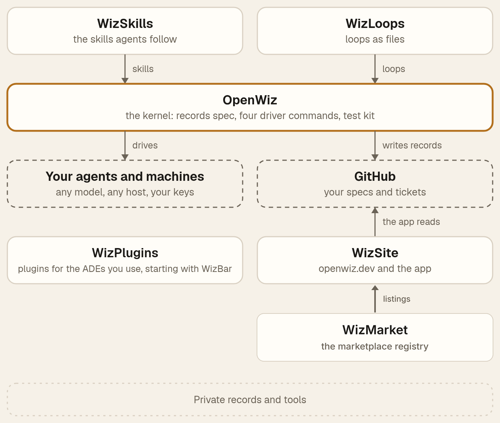

<picture>
  <source media="(prefers-color-scheme: dark)" srcset="https://raw.githubusercontent.com/openwizdev/.github/main/profile/art/banner-dark.png">
  
</picture>

**OpenWiz is the open kernel for agent factories. Bring your own everything. Owned by no one.**

- **You make the decisions.** Answer a few questions about what you want built.
- **The agents run the factory.** They write the spec and the tickets, build, review and merge.
- **You watch it ship.**

The kernel is small: records on GitHub, four driver commands (`version`, `start`, `wake`, `stop`) and a test kit. Your agents run on your computer or a VPS, on Cloudroom, or on boat.dev. OpenWiz never touches a login, and there is no server of ours.

It builds itself, in public. **Status:** before 0.1.0; 0.1.0 is coming soon.

<picture>
  <source media="(prefers-color-scheme: dark)" srcset="https://raw.githubusercontent.com/openwizdev/.github/main/profile/art/map-dark.png">
  
</picture>

| Repo | What it is | Licence |
| --- | --- | --- |
| [OpenWiz](https://github.com/openwizdev/OpenWiz) | The kernel: records, drivers, test kits and the `openwiz` command | Apache-2.0 |
| [WizSkills](https://github.com/openwizdev/WizSkills) | The skills your agents follow: spec, tickets, build, review | Apache-2.0 |
| [WizLoops](https://github.com/openwizdev/WizLoops) | Loops as files: what wakes the factory, and when | Apache-2.0 |
| [WizSite](https://github.com/openwizdev/WizSite) | [openwiz.dev](https://openwiz.dev) and the app that shows your factory | Apache-2.0 |
| [WizPlugins](https://github.com/openwizdev/WizPlugins) | Cloudroom plugins: the WizBar sidebar (optional, outside 0.1.0) | MIT |

[openwiz.dev](https://openwiz.dev) · [the app](https://openwiz.dev/app/) · [Changelog](https://openwiz.dev/changelog/)
