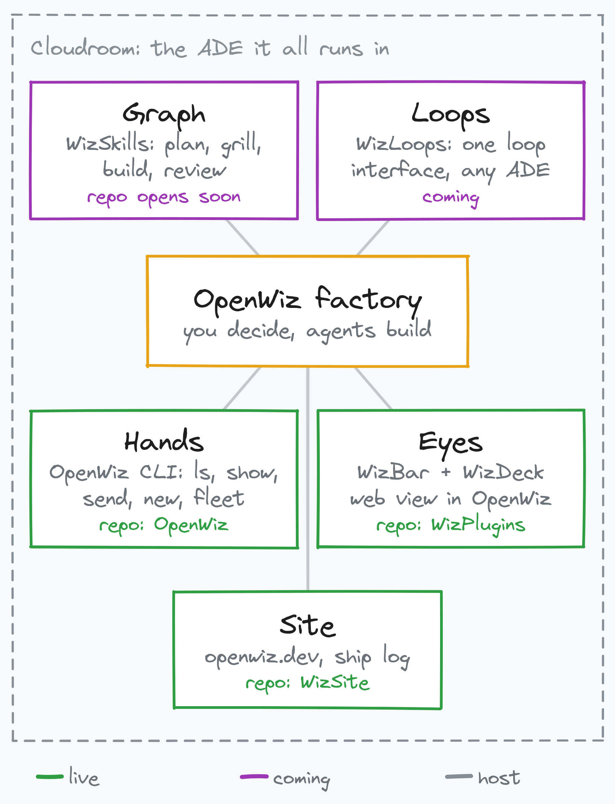

  <picture>
    <source media="(prefers-color-scheme: dark)" srcset="brand/openwiz-lockup-dark.svg">
    
  </picture>

<b>A fully open source software factory.</b> You decide; agents build.

## The map

- **The factory: [OpenWiz](https://github.com/openwizdev/OpenWiz).** You decide; agents build.
- **Graph: WizSkills.** The plan, grill, build and review skills. The repo opens soon.
- **Loops: WizLoops.** One loop interface for any ADE. Coming.
- **Hands: [the OpenWiz CLI](https://github.com/openwizdev/OpenWiz).** `ls`, `show`, `send`, `new`, `fleet`.
- **Eyes: [WizBar and WizDeck](https://github.com/openwizdev/WizPlugins)** inside Cloudroom, plus the [web view](https://github.com/openwizdev/OpenWiz/tree/main/apps/web) in OpenWiz.
- **Site: [WizSite](https://github.com/openwizdev/WizSite),** the source of [openwiz.dev](https://openwiz.dev).
- **Host: Cloudroom,** the ADE it all runs in.

Each repo's README has its own map of its parts.
